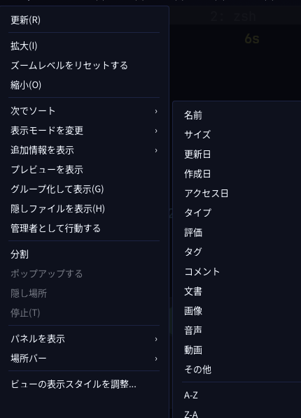

# Global application menu — state and evidence

## What the shell does

The bar shows the focused application's menu between the app icon/title and the
tray. It reads the menu two ways:

- **Canonical AppMenu Registrar + `com.canonical.dbusmenu`** — what Mavernix
  (the reference in issue #47) does; Qt apps such as Dolphin register here.
- **AT-SPI** — a fallback for apps that export a menubar through their
  accessibility tree but never register with the Canonical registrar.

Because the bar is a layer-shell surface, a GTK popover cannot hang from it
(Wayland only allows an `xdg_popup` to hang from an `xdg_toplevel`). The menu is
therefore a card in its own overlay surface, hung under the bar the way the
calendar is (`internal/ui/appmenu_panel.go`).

**Submenus cascade**: each one is a column of its own, beside the item it hangs
from and level with it, as a Mac's menus do, rather than rows indented into the
parent list. Column positions come from GTK's own measurement, not from style
sheet row heights.



## What is verified on the real desktop (hx90, Hyprland)

- Menu labels for the focused Qt application appear in the bar (Dolphin:
  ファイル / 編集 / 表示 / 移動 / ツール / 設定 / ヘルプ).
- Clicking a label opens the section; hovering an item with a submenu opens the
  submenu beside it, level with the item, with a gap between the columns.
- `←` / `Esc` step back one level, then close; a click outside closes.
- The screenshot above is that behaviour, captured from the live session.

## What is implemented but not yet proven end to end

Every inua application now builds a menu model and shows it in its own window:

| Where | Apps |
| --- | --- |
| `internal/lightui` | Clock, Weather, Stocks, Calculator, Calendar, Color Picker, System Monitor, Tailscale, Pass, GPG, Music, Video, Workshop |
| `internal/gamesui` | Minesweeper, Space Pinball, Small Fortune, Chinese Checkers |
| `internal/filesui` | Files |
| `internal/mailui` | Mail |
| `internal/termui` | Terminal (Applications menu, also on Linux now) |

`internal/appui/menu.go` builds the `GMenu` and the `GtkPopoverMenuBar` from a
`[]MenuGroup`; `internal/appui/app.go` keeps the accessibility bridge on
(`GTK_A11Y=atspi`) because the shell reads menus through AT-SPI.

## The open problem

For inua's own GTK4 applications the bar still shows **no labels**. Their
accessibility tree reaches the shell as a skeleton only:

```
role=75 (application) -> role=23 (frame) -> role=39 (panel)
  -> role=34 (menu bar) -> role=35 (menu item) -> role=29 (label)
```

one unnamed child per level, and `ChildCount` reporting 0 where `GetChildren`
returns 1. GTK4's `GtkPopoverMenuBar` therefore does not hand the reader the
individual top-level menus through AT-SPI, so the registrar path is the one that
will work for our own apps too.

## Next step

Publish each inua application's menu over **`com.canonical.dbusmenu`** and
register the window with `com.canonical.AppMenu.Registrar` from `internal/appui`
— the same pair the shell already speaks for Dolphin. That removes AT-SPI from
the path entirely and makes the inua apps first-class citizens of the bar.

## Test hooks

`INUA_APPMENU_DEBUG=1` makes the shell log each section button's box
(`appmenu-bounds …`), so a test script can click the label it wants instead of
guessing at pixels.
